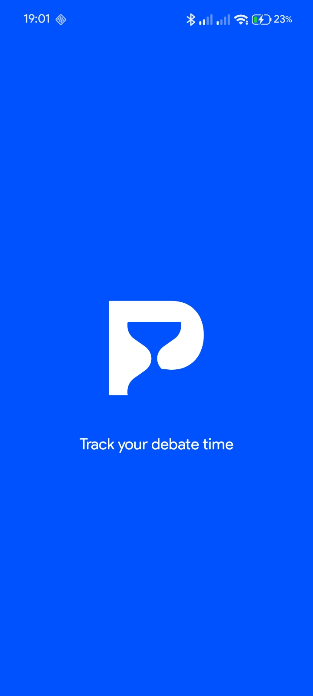
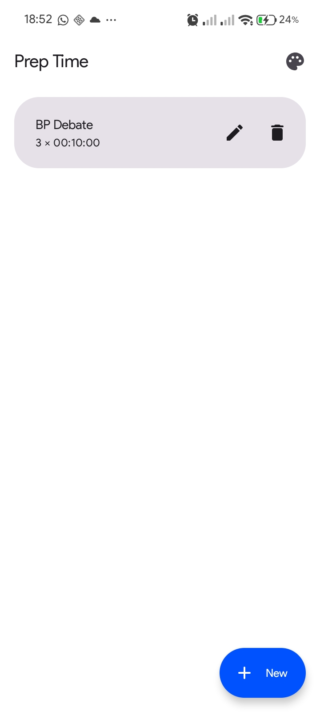
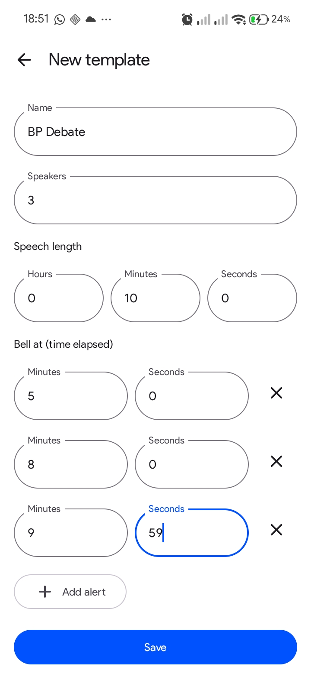
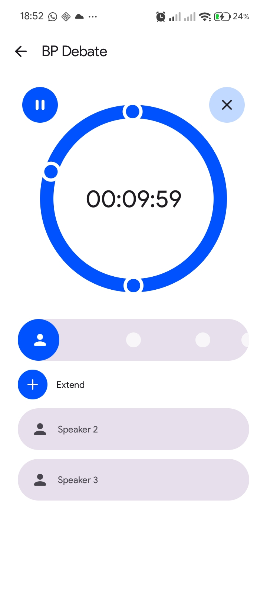
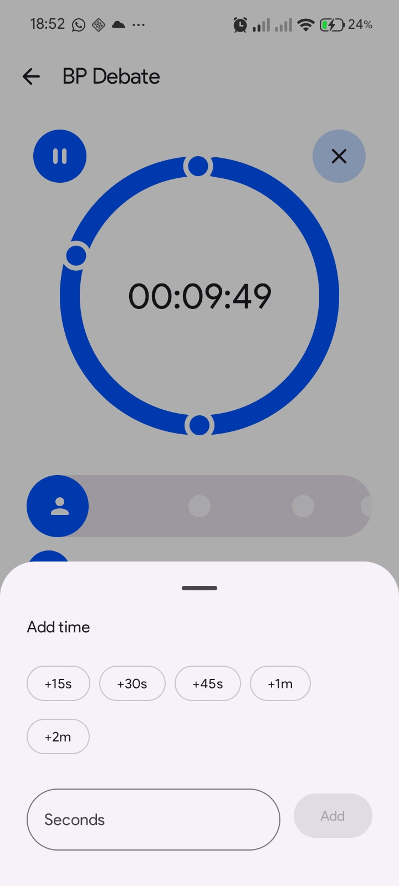
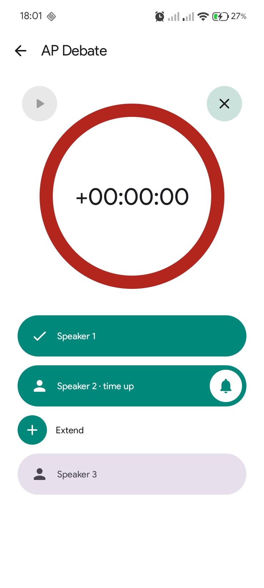

<p align="center">
  
</p>

<h1 align="center">Prep Time</h1>
<p align="center"><b>A debate time keeper for Android.</b><br>
Set up a round once, then press Start for each speaker. Prep Time rings a bell the whole room can hear.</p>

<p align="center">
  <a href="https://github.com/mahtamun-hoque-fahim/prep-time/raw/main/release/PrepTime-1.1.apk"><b>⬇ Download Prep Time 1.1 (APK, 2.9 MB)</b></a>
</p>

---

## Why Prep Time?

Keeping time at a debate is busy work. Speakers change quickly, the room needs to hear the warnings, and nobody wants to re-enter a timer between speeches.

- **Set up once.** Make a template, say "BP Debate, 3 speakers, 7 minutes, bells at 1:00 and 6:00". Every speaker gets the same time and the same bells.
- **One tap per speaker.** When the next speaker reaches the dias, press **Start**. That's it.
- **A bell everyone hears.** Warning bells ring once. When time is up, the bell keeps ringing until you stop it, so speakers can't pretend they didn't hear it.
- **Grant extra time in a tap.** +15s, +30s, +45s, +1m, +2m, or any number of seconds.
- **The countdown follows you.** Switch to another app and the time keeps ticking in a small pill at the top of the screen, like the Clock app's timer (Android 16).
- **Works offline, no account, no ads.**

## Screenshots

| Your debates | Set up a round | Speaker on the clock |
|:---:|:---:|:---:|
|  |  |  |

| Add extra time | Time's up — the bell rings |
|:---:|:---:|
|  |  |

## Install

1. On your Android phone, open the **[download link](https://github.com/mahtamun-hoque-fahim/prep-time/raw/main/release/PrepTime-1.1.apk)**.
2. Open the downloaded `PrepTime-1.1.apk`.
3. If Android asks, allow your browser or file manager to **install unknown apps**, then tap **Install**.
4. Open Prep Time and tap **Allow** when it asks to send notifications. That's what shows the countdown pill.

Needs Android 9 or newer. The countdown pill needs Android 16; older phones show a regular notification with the countdown instead.

**Already have 1.0?** Install 1.1 the same way. It updates in place and keeps your debates.

## How to use it

### 1. Create a debate
Tap **New** and fill in:
- **Name**, for example "AP Debate".
- **Speakers**: how many people speak (1 works for a single speaker).
- **Speech length** in hours, minutes and seconds.
- **Bell at**: add as many bells as you want, counted from the start of the speech. For a 10-minute speech, bells at 5:00 and 7:00 ring 5 and 7 minutes in.

Tap **Save**.

### 2. Run the round
Tap your debate. You'll see the big countdown ring with one bar per speaker below it.

| Control | What it does |
|---|---|
| **Start** on a speaker's bar | Starts that speaker's time |
| **▶ / ❚❚** (left of the ring) | Pause and resume the clock, for example for a point of order |
| **✕** (right of the ring) | End the current speaker's turn, for example if they finish early |
| **+ Extend** | Add time to the current speaker |
| **🔔** on the bar (when time is up) | Stop the bell and move on to the next speaker |

The dots on the ring and on the speaker's bar show where the bells will ring.

### 3. When time runs out
The ring turns red and the clock counts **overtime** (`+00:00:12`) so you know how far over the speaker went. The bell keeps ringing until you tap 🔔. If the judge grants more time, tap **+ Extend** instead. That silences the bell and restarts the countdown from the added time.

## Good to know

- **The bell plays even when your phone is on silent.** Prep Time uses the alarm sound and raises the alarm volume to full while a timer is open. It puts your volume back when you leave.
- **The screen stays on** while the timer is open, and the bells still ring on time if the screen turns off.
- **The time-up bell is your phone's alarm sound.** To change it, change the default alarm sound in your phone's settings.
- **Themes:** tap the palette icon on the home screen to pick a colour and switch between Light, Dark or System.
- **Leaving mid-speech** asks you to confirm first, so you don't stop a speaker's clock by accident.

## For developers

Kotlin, Jetpack Compose and Material 3, built with Gradle.

```bash
./gradlew assembleDebug        # debug APK in app/build/outputs/apk/debug/
./gradlew testDebugUnitTest    # unit tests for the timer logic
```

Release builds are signed using a `keystore.properties` file in the project root. The file is kept out of git; without it, release builds come out unsigned.

The design notes are in [`docs/superpowers/specs`](docs/superpowers/specs/2026-10-30-debate-timekeeper-design.md).
